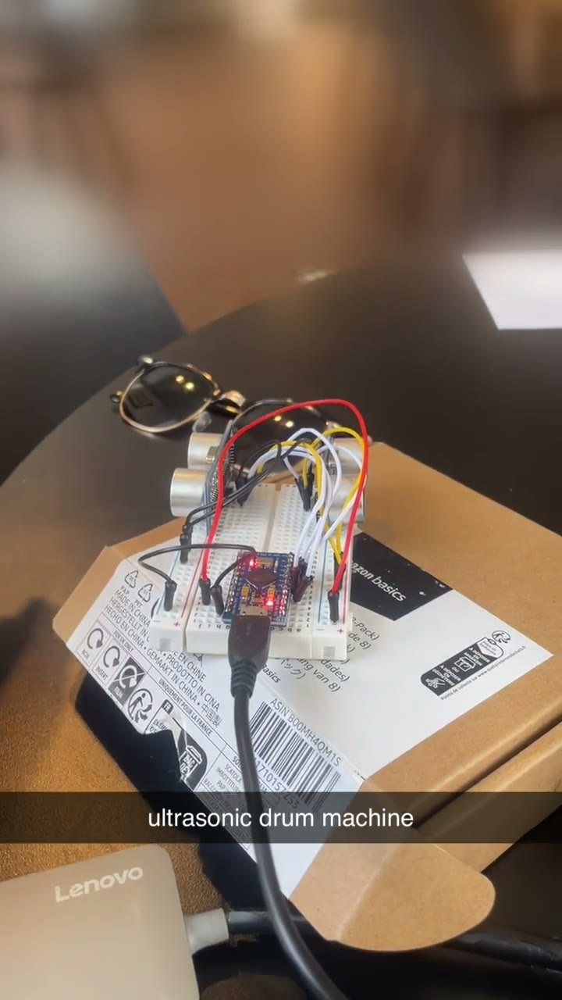
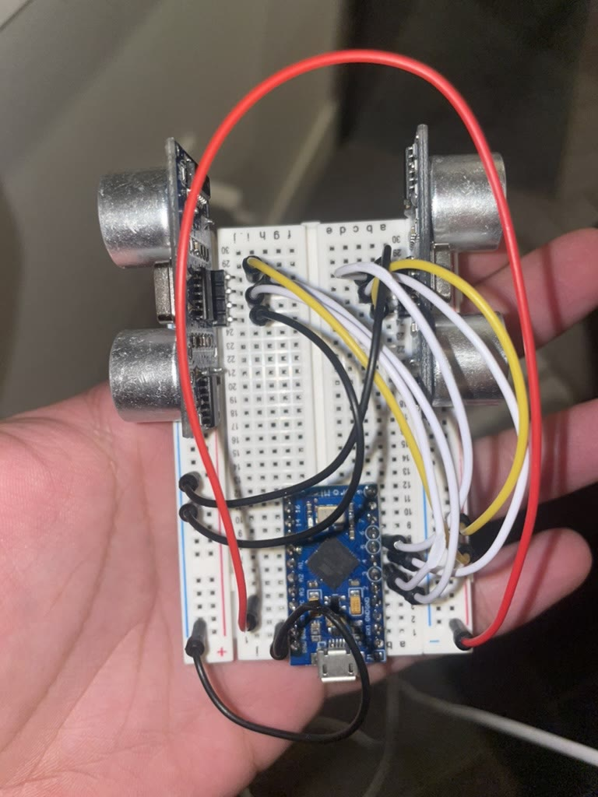

# ultrasonic-drums

**A drum machine you play in the air.** Two ultrasonic distance sensors read how close your hands are, and an Arduino turns that into MIDI drum hits over USB. Plug it into a computer and it shows up as a MIDI instrument.

By **Ahmed Jamal Malik**, 2024.

|  |  |
|---|---|
| **Playing it in GarageBand** (14 s, click to watch) | **The build:** two sensors and a Pro Micro on a breadboard |

| Hand distance | Drum | MIDI note |
|---|---|---|
| under 10 cm | Kick | 36 |
| 10–20 cm | Snare | 38 |
| 20–30 cm | Closed hi-hat | 42 |
| further away | nothing | |

Each sensor works on its own, so left and right hands can play different drums at once. A drum hits when your hand enters its zone; holding still doesn't repeat it.

## Build it

You need an Arduino with native USB (a Pro Micro like this one, a Leonardo or a Micro; an Uno can't act as a USB MIDI device) and two HC-SR04 sensors.

| HC-SR04 | Left | Right |
|---|---|---|
| VCC | 5V | 5V |
| GND | GND | GND |
| Trig | pin 2 | pin 4 |
| Echo | pin 3 | pin 5 |

1. In the Arduino IDE, install the **MIDIUSB** library (Tools → Manage Libraries).
2. Open [`ultrasonic_drums/ultrasonic_drums.ino`](ultrasonic_drums/ultrasonic_drums.ino), pick your board and upload.

## Play it

It's a standard USB MIDI device, so no driver is needed. In GarageBand, make a Software Instrument track with a drum kit and start playing. In any other DAW, enable the Arduino as a MIDI input and put a drum instrument on the track. It sends on channel 10, the General MIDI drum channel.

To change the feel, edit the zone edges and notes at the top of the sketch.

## How it works

Each sensor sends an ultrasonic ping and times the echo. A missed echo is ignored rather than read as zero distance, and a note only ends after three misses in a row, so an unreliable reading can't fire a false kick or retrigger a held drum. The wait for an echo stops at 6 ms, so one sensor can't stall the other.

---

Code under the [MIT License](LICENSE).
